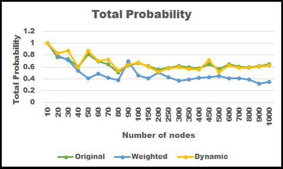
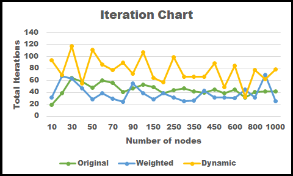

# PageRank: Analysis, Implementation and Improvements

A C++ implementation of Google's PageRank algorithm, plus two modified versions that change how a page shares its rank across its outgoing links. The three methods are compared on graphs of 10 to 1,000 pages.

This was a 5th-semester Computer Science and Engineering project at **IIT (ISM) Dhanbad**, completed in November 2017 under the guidance of Prof. G.P. Biswas.

**Team:** Pritam Ghosh, Ayush Kumar, Romit Kumar, Megha Garg

The full write-up, with formulas, code listings and outputs, is in [`PageRank.tex`](PageRank.tex).

## The algorithms

Every method starts each page at a rank of 1/N and uses a damping factor of **d = 0.85**, the probability that a random surfer keeps clicking links.

**Original PageRank.** Each page splits its rank equally among its outgoing links:

$$PR_k(p_i) = \frac{1-d}{N} + d \sum_{p_j \in M(p_i)} \frac{PR_{k-1}(p_j)}{L(p_j)}$$

Here $M(p_i)$ is the set of pages linking to $p_i$, and $L(p_j)$ is the number of links going out of $p_j$.

**Modified 1: Weighted graph.** One site can link to another several times, so each link has a weight, and a page's rank is split in proportion to those weights:

$$PR_k(p_i) = \frac{1-d}{N} + d \sum_{p_j \in M(p_i)} PR_{k-1}(p_j)\,\frac{w(p_j p_i)}{\sum_{p_m \in S(p_j)} w(p_j p_m)}$$

**Modified 2: Dynamic probability.** A page passes more of its rank to the pages that already rank higher. This models a surfer who is more likely to click on important pages:

$$PR_k(p_i) = \frac{1-d}{N} + d \sum_{p_j \in M(p_i)} PR_{k-1}(p_j)\,\frac{PR_{k-1}(p_i)}{\sum_{p_m \in S(p_j)} PR_{k-1}(p_m)}$$

In both formulas, $S(p_j)$ is the set of pages that $p_j$ links to.

## Results

The three methods were run on the same set of links with d = 0.85. For the weighted method, each link's weight was a random number from 1 to N. The table shows some of the 23 graph sizes tested. The full table is in the report.

| Pages (n) | Total probability: Original | Weighted | Dynamic | Iterations to converge: Original | Weighted | Dynamic |
|---:|---:|---:|---:|---:|---:|---:|
| 10 | 1.000 | 1.000 | 1.000 | 19 | 31 | 94 |
| 50 | 0.810 | 0.407 | 0.870 | 48 | 28 | 111 |
| 100 | 0.671 | 0.463 | 0.681 | 53 | 39 | 107 |
| 500 | 0.569 | 0.447 | 0.518 | 39 | 31 | 49 |
| 1000 | 0.644 | 0.351 | 0.628 | 42 | 25 | 78 |




**Conclusion.** The dynamic method gives results closest to the original algorithm and better matches how a real person surfs the web. The original algorithm needs fewer iterations to converge.

## Repository layout

### Final project (main folder)

| File | What it does | Input file | Output file |
|---|---|---|---|
| `pr.cpp` | Original PageRank, 2500 iterations | `input0.txt` | `output0.txt` |
| `pri.cpp` | Original PageRank until convergence, counting the iterations | `input1.txt` | `outputi1.txt` |
| `prw.cpp` | Weighted graph, 2500 iterations | `input0.txt` | `outputw.txt` |
| `prwi.cpp` | Weighted graph until convergence | `inputw.txt` | `outputw.txt` |
| `prd.cpp` | Dynamic probability, 2500 iterations | `input0.txt` | `outputd0.txt` |
| `prdi.cpp` | Dynamic probability until convergence | `input0.txt` | `outputdi0.txt` |

The convergence versions stop when no page's rank changes by more than 10⁻⁸ between iterations.

### Early prototype (`2017-original/`)

The first version from October 2017, which used to be the separate `PageRank-in-MATLAB` repository. Its commit history is kept here.

| File | What it does |
|---|---|
| `pagerank.cpp` | Original PageRank, 10 iterations |
| `pagerank_it.cpp` | Original PageRank until convergence |
| `pagerank_mod.cpp` | Modified version where pages don't all start with equal rank |
| `pagerank_mod_it.cpp` | Modified version until convergence |

These programs read from the keyboard. They ask for the number of sites, then for each site the number of outgoing links followed by the linked sites. Each `.png` in the folder shows the output of the program with the same name.

## Running the code

```bash
g++ -O2 -o pr pr.cpp
./pr            # reads input0.txt, writes output0.txt
```

The final-project programs read a graph file from the same folder:

```
n m        # number of pages, number of links
x y        # one line per link, from page x to page y (pages are numbered 1..n)
...
```

`prw.cpp` and `prwi.cpp` take a weight on each link line instead: `x y w`. `prwi.cpp` also expects the number of test cases on the very first line.

The graphs used in the report aren't included in this repository. To try the programs, create your own input file in the format above, with at most 1,099 pages.
